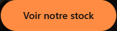
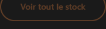
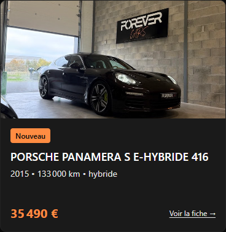
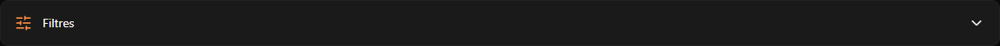
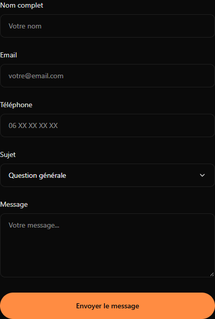
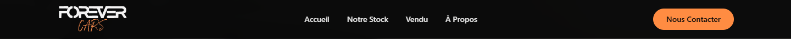
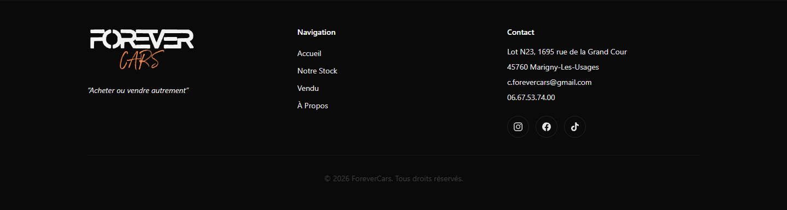

# Charte ForeverCars

> Relevée dans le code **et le rendu réel** de `apps/site` (CSS compilé, captures du site en local).
> Partagée par le site et le back-office. Thème : **sombre**, décidé le 22/11/2026.

## Couleurs

| Token | Valeur | Usage sur le site | Source |
| --- | --- | --- | --- |
| `brand-black` | `#0A0A0A` | Fond de page, champs de formulaire | `globals.css` (@theme) |
| `brand-gray-dark` | `#1A1A1A` | Cartes, sections alternées | `globals.css` |
| `brand-gray-medium` | `#404040` | Bordures (à 20 % ou 40 %), fond d'image vide | `globals.css` |
| `brand-gray-light` | `#E5E5E5` | Texte secondaire, libellés | `globals.css` |
| `brand-white` | `#FFFFFF` | Titres, texte principal, badge « Réservé » | `globals.css` |
| `brand-orange` | `#FF8C42` | Accent : boutons, prix, badge « Nouveau », focus | `globals.css` |
| `brand-success` | `#4ADE80` | Confirmations (« Lien copié », « Message envoyé ») | `text-green-400` dans les composants |
| `brand-danger` | `#EF4444` | Messages d'erreur | `text-red-500` dans le formulaire |

`tailwind.config.ts` déclare d'autres valeurs (`#131313`, `#FE904D`) mais **Tailwind v4 ne lit pas ce fichier** : elles ne s'affichent nulle part.

## Typographie

| Rôle | Rendu réel | Tailles relevées |
| --- | --- | --- |
| Corps | **Inter** 400 / 500 / 600 | `text-sm` (le plus fréquent), `text-xs` pour les petits libellés |
| Titres | **Inter** 600 / 700 (voir décision 1) | H1 `text-4xl` → `md:text-5xl`, H2 `text-3xl` → `md:text-4xl`, H3 `text-lg` à `text-xl` |
| Prix | Inter 700 en orange | `text-xl` (carte), `text-3xl` (fiche) |

## Formes

| Élément | Valeur |
| --- | --- |
| Rayon cartes, champs, conteneurs | `rounded-lg` = 0,625 rem (10 px) |
| Rayon boutons, pastilles, filtres | `rounded-full` (pilule) |
| Rayon petits badges (« Nouveau ») | `rounded` (4 px) |
| Bordure carte | 1 px `brand-gray-medium` à 20 %, orange à 50 % au survol |
| Bordure champ | 1 px `brand-gray-medium` à 40 %, orange au focus |
| Ombres | Rares : `shadow-lg` (tampon « Réservé »), halo orange au survol du bouton du header |
| Mouvement | Transitions de 300 ms (couleurs, bordure, léger zoom de carte à 102 %) |

## Mise en page

Conteneur `max-w-6xl` (texte : `max-w-3xl` / `max-w-4xl`), sections `py-16` à `py-20`, grilles `gap-6` à `gap-8`.

## Composants de référence

| Composant | Classes clés | Capture |
| --- | --- | --- |
| Bouton primaire | `bg-brand-orange text-brand-black rounded-full px-8 py-3 text-sm font-semibold` |  |
| Bouton secondaire | `border-2 border-brand-orange text-brand-orange rounded-full`, plein orange au survol |  |
| Carte véhicule | `bg-brand-gray-dark rounded-lg border`, image `h-48`, badge « Nouveau », prix orange, lien « Voir la fiche → » |  |
| Filtres | Barre `bg-brand-gray-dark rounded-lg`, pastilles `rounded-full` orange quand actives |  |
| Champ de formulaire | Libellé `text-sm text-brand-gray-light` (casse normale), champ `bg-brand-black border rounded-lg px-4 py-3` |  |
| Header | `bg-brand-black/95 backdrop-blur`, logo, liens soulignés en orange au survol, bouton « Nous Contacter » |  |
| Footer | 3 colonnes, logo, navigation, contact, réseaux sociaux |  |

## Marque

- **Logo** : `Forever-CarsLogo.svg`, « FOREVER » en blanc et « CARS » manuscrit orange. **Prévu pour fond sombre** (sur fond clair, le poser sur un bandeau noir).
- **Icône / favicon** : `Logo.svg`.
- **Slogan** : « Tu t'occupes de rien, je m'occupe de tout ». **Accroche** : « Acheter ou vendre autrement ».

## Ton éditorial

- **Vouvoiement** partout (« Votre prochain véhicule vous attend », 37 occurrences). Le tutoiement est réservé au slogan.
- Phrases courtes et directes, vocabulaire simple et concret (« On s'occupe du reste »).
- Constat sur les données : les marques et modèles sont saisis **en majuscules** dans Sanity (« BMW », « GOLF GTI TCR ») et affichés tels quels.

## Règles pour le back-office

- Aucune couleur, police, ombre ou rayon en dehors des tokens ci-dessus.
- Textes de l'interface au vouvoiement, dans le même ton que le site.
- Contraste AA minimum, cibles cliquables ≥ 44 px, focus visible en orange.

## Décisions (22/11/2026)

1. **Titres en Orbitron** : on répare la classe pour afficher la police prévue (option B).
2. **`brand-success` et `brand-danger`** validés comme tokens officiels.
3. **Libellés des champs en petites majuscules** dans le back-office.

Ces décisions valent pour la charte **actuelle**. La refonte visuelle (phase 1 bis) peut les remplacer.

## Bilan de l'audit

**Ce qui marche**
- Le contraste noir + orange : fort, reconnaissable, cohérent avec le logo.
- Le logo : « FOREVER » géométrique + « CARS » manuscrit, il a une vraie personnalité.
- Les vraies photos du garage (voitures devant le mur au logo) et la vidéo du hero : authentiques.
- Le ton : court, direct, le slogan au tutoiement se retient.
- Les cartes véhicule : lisibles, le prix ressort.

**Ce qui fait daté ou générique**
- Mise en page « modèle de site » : chaque section = titre centré + 3 cartes identiques, icônes dans des ronds orange.
- Hero : voile noir uniforme à 70 % qui écrase la vidéo, texte centré sans hiérarchie.
- Typographie : une seule police rendue (Inter) partout, aucun contraste entre titres et texte ; Orbitron (« futuriste ») peut faire années 2015 si on la répare telle quelle.
- Photos hétérogènes : fonds, cadrages et lumières variables d'un véhicule à l'autre.
- Données en MAJUSCULES qui crient dans les cartes (« PORSCHE PANAMERA S E-HYBRIDE 416 »).
- Peu d'éléments de confiance visibles (avis, garantie, fondateur) en dehors de la page À propos.
- Animations : fondus génériques identiques partout (la branche `test-apple-design` corrige déjà une partie).
